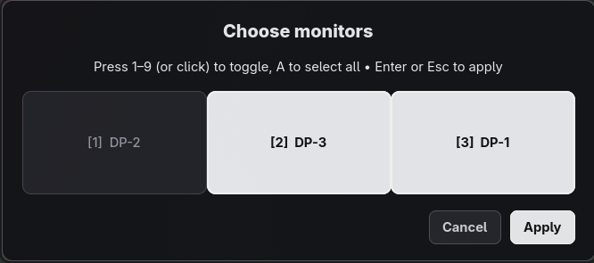

# Hyprstretch

Stretch a window across chosen Hyprland monitors without floating it. Super easy!

I looked into [Hyprspan](https://github.com/gondhijagapathi/hyprspan), but it didn't do everything I wanted, so I built this! This works for every application I've tested so far, such as Assetto Corsa and terminals that don't request multi-monitor spanning themselves!

Hyprstretch also includes a simple GUI monitor selector in case you only want to span part of your setup:



Full disclosure: This was created entirely by Codex (ChatGPT AI). It ran the tests it created, then loaded the plugin. I manually tested it, and it works how I expect!
I do not take responsibility for issues it causes or configurations it may break; I can only say it works fine in my environment, but I don't see why it wouldn't work on others.

## Use

Focus a window and press **Super+Shift+G**. Click the physical monitor tiles to
choose a span, then apply. The active window's monitor is selected by default.
Press **Escape**, **Super+Shift+G**, or **Super+G** to close the picker. When the
picker is closed, **Super+G** toggles the configured monitor span for the focused
window.

## Configure the bindings

Add these to your Hyprland Lua config. Replace the project path and monitor names
with yours:

```lua
local hyprstretch = "/home/you/src/hyprstretch"

hl.bind("SUPER + G",
    hl.dsp.exec_cmd("python3 " .. hyprstretch .. "/tools/toggle.py LEFT CENTER RIGHT"),
    { description = "Toggle span or close picker" })

hl.bind("SUPER + SHIFT + G",
    hl.dsp.exec_cmd("python3 " .. hyprstretch .. "/tools/picker.py"),
    { description = "Choose monitors for active window" })
```

The picker captures the active window before opening. Super+G detects and closes
the picker. Otherwise, it passes the listed output names to the plugin's `toggle`
command, which restores the focused window if it is already stretched. The picker
needs Python 3, GTK 4, and PyGObject.

## Install

Hyprstretch targets Hyprland 0.57 and needs matching headers, a C++26 compiler,
`make`, `pkg-config`, and Hyprland's development dependencies.

```sh
make
hyprctl plugin load "$PWD/build/hyprstretch.so"
```

## Limits

Selected monitors must form one contiguous horizontal row and share a logical
height and scale. Include the window's current monitor. Pinned, grouped, and
special-workspace windows are unsupported. XWayland requires
`xwayland:force_zero_scaling` off. Rebuild after Hyprland updates.

## Checks

```sh
make
make test
make build/window-fixture
python3 tests/picker_smoke.py
python3 tests/integration.py
```

The integration checks use a nested compositor and do not control the parent
session. MIT license. Developed by Ryan Parker with AI assistance.
