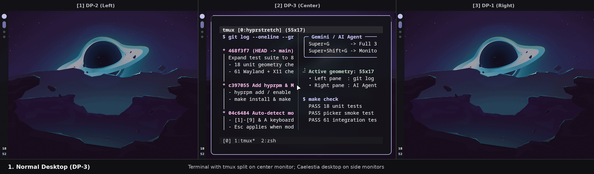

# Hyprstretch

**Global fullscreen** and **partial multi-monitor fullscreen** for Hyprland—stretch any window across all (or a chosen subset) of your monitors without floating it. Super easy!

Hyprland doesn't include built-in global fullscreen across multiple monitors yet, and while I looked into [Hyprspan](https://github.com/gondhijagapathi/hyprspan), it didn't do everything I wanted—so I built **Hyprstretch**! It works with every Wayland and XWayland application I've tested so far, including sim-racing games like *Assetto Corsa* across triple monitors, ultrawide workflows, and terminals or apps that don't support multi-monitor spanning on their own.



### Modes: Global Fullscreen vs. Partial Fullscreen

- **Global Fullscreen (Default Span):** Stretches the focused window across your entire horizontal monitor row (or your configured default monitors) in one keypress, and restores its exact original tiled/floating geometry when toggled off.
- **Partial Fullscreen (GUI Monitor Picker):** Want a window stretched across just 2 of your 3 monitors, or want to exclude an extra TV/side display? Open the visual monitor picker (`tools/picker.py`), press `1`–`9` (or click) to toggle the monitors you want (`A` selects all), and press `Enter` or `Esc` to apply:


Full disclosure: This was created entirely by AI (Codex + Gemini). It ran an extensive set of tests it created, then loaded the plugin. I manually tested everything, and it works how I expect!
I do not take responsibility for issues this plugin causes or configurations it may break; I can only say it works fine in my environment -- I don't see why it wouldn't work on others just as well, though.

## Install

Hyprstretch targets Hyprland 0.57 and needs matching headers, a C++26 compiler, `make`, `pkg-config`, and Hyprland's development dependencies. The optional GUI picker requires Python 3, GTK 4, and PyGObject (`python-gobject`).

### Method 1: Using `hyprpm` (Recommended for Plugin Management)

```sh
hyprpm update
hyprpm add https://github.com/rparker2003/hyprstretch
hyprpm enable hyprstretch
```

### Method 2: From Source (`git clone` + `make install`)

```sh
git clone https://github.com/rparker2003/hyprstretch.git
cd hyprstretch
make install
make reload
```

`make install` installs the plugin into `~/.local/lib/hyprstretch/current.so` and installs `hyprstretch-toggle` and `hyprstretch-picker` into `~/.local/bin`.

## Configure Keybindings

Hyprstretch does not hardcode any keybindings, so it never collides with your existing config. Below are the recommended bindings (`SUPER + G` for instant global fullscreen toggle, and `SUPER + SHIFT + G` for the interactive monitor picker).

### Option A: Standard `hyprland.conf`

```ini
# Load the plugin on startup (if not using hyprpm: exec-once = hyprpm reload -n)
exec-once = hyprctl plugin load ~/.local/lib/hyprstretch/current.so

# Optional: restrict default automatic toggle to specific monitors
# plugin:hyprstretch:outputs = DP-2 DP-3 DP-1

# Auto-detect all monitors in the active window's horizontal row:
bind = SUPER, G, exec, ~/.local/bin/hyprstretch-toggle

# Or specify exact monitor interfaces (order does not matter; sorted left-to-right automatically):
# bind = SUPER, G, exec, ~/.local/bin/hyprstretch-toggle DP-1 DP-2 DP-3
# bind = SUPER, G, exec, hyprctl hyprstretch toggle HDMI-A-1 DP-1

# Open the visual monitor picker for partial/custom spans:
bind = SUPER SHIFT, G, exec, ~/.local/bin/hyprstretch-picker
```

### Option B: Hyprland Lua Config (`hyprland.lua`)

```lua
-- Auto-detect all monitors in the active window's horizontal row:
hl.bind("SUPER + G",
    hl.dsp.exec_cmd("~/.local/bin/hyprstretch-toggle"),
    { description = "Toggle global fullscreen span or close monitor picker" })

-- Or specify exact monitor interfaces (e.g. triple DP setup or dual HDMI+DP):
-- hl.bind("SUPER + G",
--     hl.dsp.exec_cmd("~/.local/bin/hyprstretch-toggle DP-1 DP-2 DP-3"),
--     { description = "Toggle span across DP-1, DP-2, and DP-3" })

hl.bind("SUPER + SHIFT + G",
    hl.dsp.exec_cmd("~/.local/bin/hyprstretch-picker"),
    { description = "Open monitor picker for partial/custom span" })
```

> **Note on Defaults:** If you do not pass monitor names to `hyprstretch-toggle` (`tools/toggle.py`) or `hyprctl hyprstretch toggle`, Hyprstretch checks `plugin:hyprstretch:outputs` and otherwise automatically detects and spans all enabled monitors sharing the active window's horizontal row and logical height (including mixed resolutions/scales such as 4K at `1.5x` alongside 1440p at `1.0x`).

## How to Use

- **Toggle Global Fullscreen (`Super+G`):** Stretches the focused window across your horizontal monitor row. Press `Super+G` again to restore the window to its original single-monitor tiled or floating state.
- **Pick Specific Monitors (`Super+Shift+G`):** Opens the visual monitor layout sorted left-to-right (`[1]`–`[9]`) with the active window's current monitor pre-selected.
  - Press `1`–`9` (or click tiles) to toggle monitors (`A` selects all monitors in the row), then press `Enter` or `Escape` (or click **Apply**) to stretch across the selected displays.
  - If you did not make any adjustments, pressing `Escape` (or `Super+Shift+G` / `Super+G`) simply dismisses the picker without changes.
  - Press `Super+G` (or your fullscreen keybind) afterward to return the window to normal.

See [`docs/API.md`](docs/API.md) for direct `hyprctl hyprstretch` CLI commands and native `hl.plugin.hyprstretch.*` Lua functions.

## Limits

Selected monitors must form one contiguous horizontal row and share a logical height (mixed physical resolutions, aspect ratios, refresh rates, and HiDPI scales are supported as long as their scaled logical heights match). Include the window's current monitor. Pinned, grouped, and special-workspace windows are unsupported. XWayland requires `xwayland:force_zero_scaling` off. Rebuild after Hyprland updates (`hyprpm update` or `make reload`).

## Checks

```sh
make check
```

The integration checks use a nested compositor and do not control the parent session. MIT license. Developed by Ryan Parker with AI assistance.

## References

- [hyprwm/Hyprland#1660](https://github.com/hyprwm/Hyprland/issues/1660) — Upstream global fullscreen feature request
- [Hyprspan](https://github.com/gondhijagapathi/hyprspan) — Multi-monitor fullscreen plugin reference
